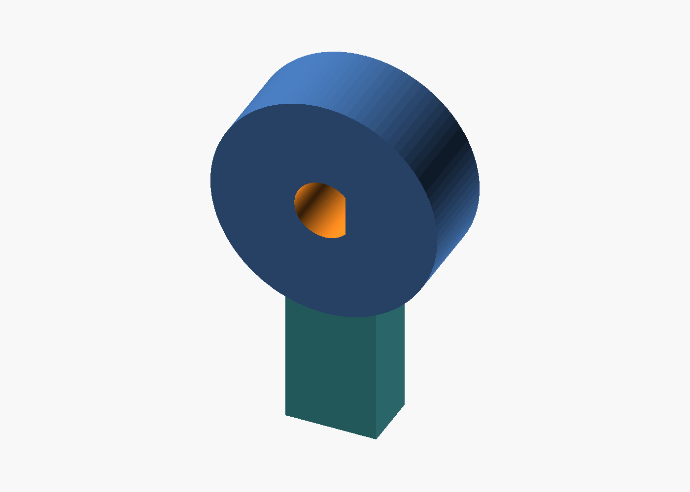

# Fridge water dispenser lever

Parametric OpenSCAD model of the removable lever piece shown on the left in the reference photo. The model is intended to fit over the dispenser-side drive feature while replacing the original handle shape.

Open `fridge_water_tap.scad` in OpenSCAD. Dimensions are in millimeters; the part is oriented with +Z up and +Y toward the user/front of the fridge.

## Fit interface

| Parameter | Current value | Meaning |
| --- | ---: | --- |
| `fit_hole_diameter` | 7 mm | Nominal round portion of the D-shaped drive opening. |
| `fit_flat_length` | 5 mm | Length of the straight edge. |
| `fit_flat_angle` | 90° | Flat orientation around the hole axis; 0° is at the top, positive angles rotate toward +X from the front. |
| `fit_clearance` | 0.4 mm per side | Offset added around the nominal opening for print fit. Tune for the printer and material. |

The current opening therefore includes print clearance around the nominal 7 mm / 5 mm D profile. Print a fit coupon before the full lever if the fit is uncertain.

## Print a fit coupon

Set `fit_demo_mode = true` to render only the 12 × 12 × 3 mm coupon with the same D-shaped opening. Its hole axis points up for a quick print without supports. Set it back to `false` to render the full lever.

## Estimated dimensions

The outer head and lever dimensions are initial estimates from the photo, not measured fit dimensions. `cup_diameter`, `cup_depth`, `cup_wall`, `lever_length`, `lever_width`, and `lever_thickness` are editable near the top of the SCAD file. Check the printed model against the original before relying on those estimates.
